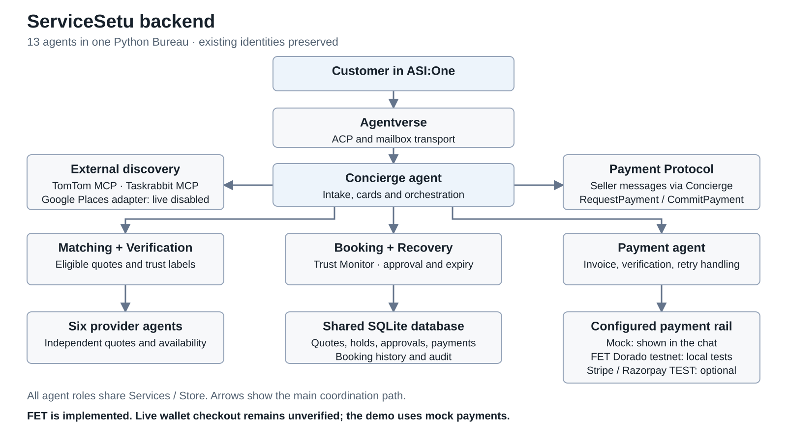
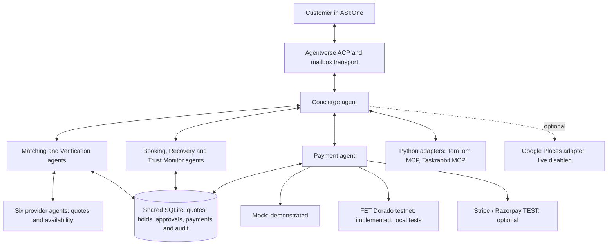

# ServiceSetu architecture

The showcase runs 13 existing identities in one Python uAgents `Bureau`: the Concierge, six internal specialists, and six provider agents. ASI:One addresses the Concierge through ACP and Agentverse mailbox transport. `MeshBus` sends typed work to the specialists; `Services` and `Store` enforce booking, approval, payment and access rules over one shared SQLite database. The diagram groups agents for readability; each keeps its own identity.

The Concierge proxies seller-side Payment Protocol messages to the customer. With `PAYMENT_MODE=fet_testnet`, explicit approval precedes a `fet_direct` request to a native `fetch1` recipient. The stored invoice binds the booking, quote, customer/session, network, exact amount, recipient and deadline. The backend verifies the Dorado ledger transfer before an eligible booking can confirm, blocks transaction reuse, and verifies a refund as a separate reverse transfer. Mainnet is refused. An `agent1` messaging address is not a payment wallet.

The 18 FET protocol/ledger tests passed using test doubles. No live customer signing, on-chain payment/refund or ASI:One FET payment-card rendering has been verified. The recorded customer journey used `mock`, not FET. TomTom discovers businesses; discovery and Taskrabbit links do not confirm ServiceSetu bookings. Google Places is implemented but live-disabled.

Source: [mesh.py](../servicesetu/mesh.py), [service.py](../servicesetu/service.py), [core.py](../servicesetu/core.py), [payments.py](../servicesetu/payments.py), [fet_payments.py](../servicesetu/fet_payments.py), [external_conversation.py](../servicesetu/external_conversation.py).
